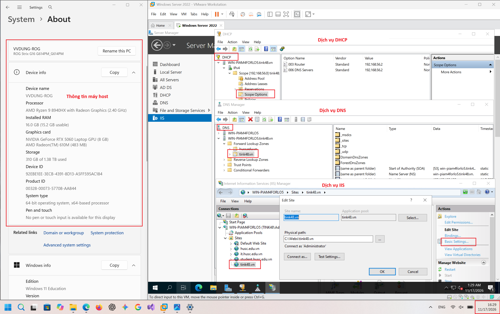
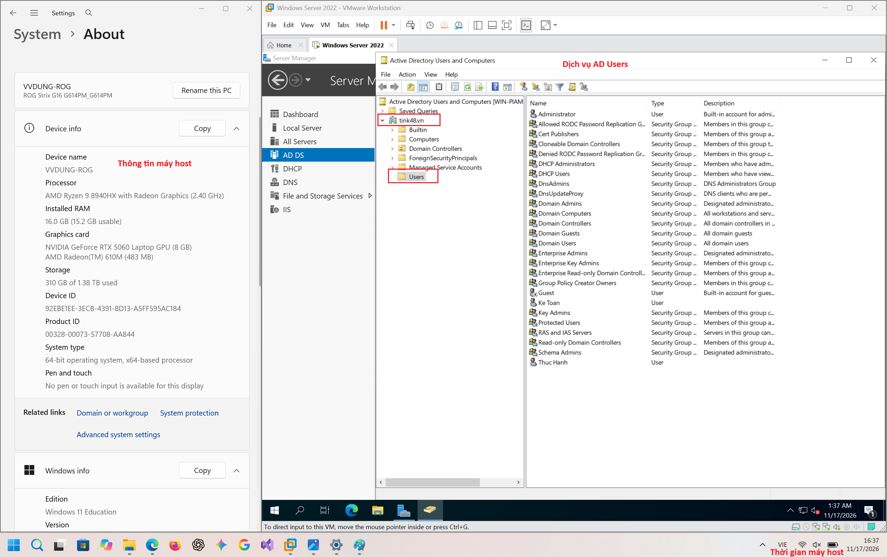
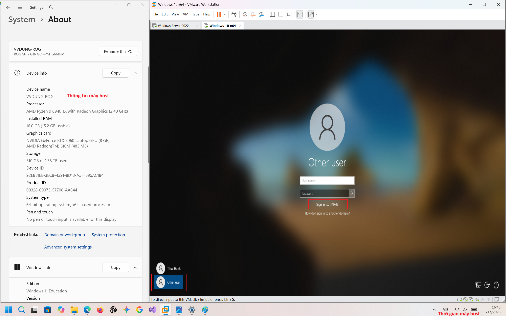
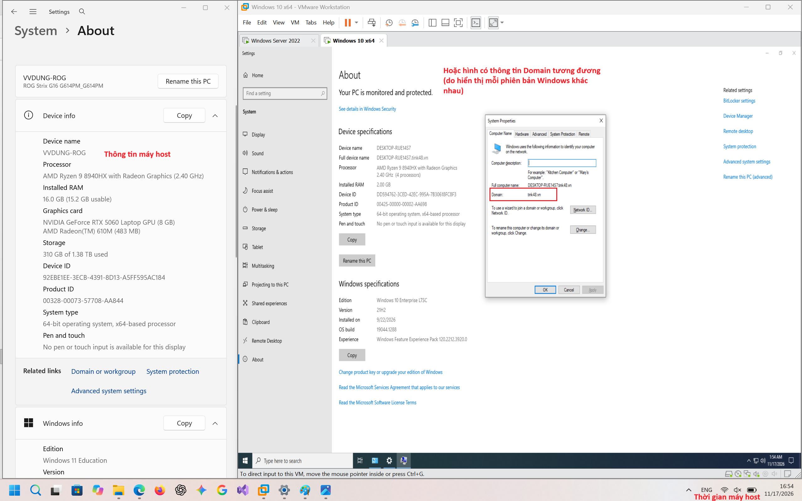
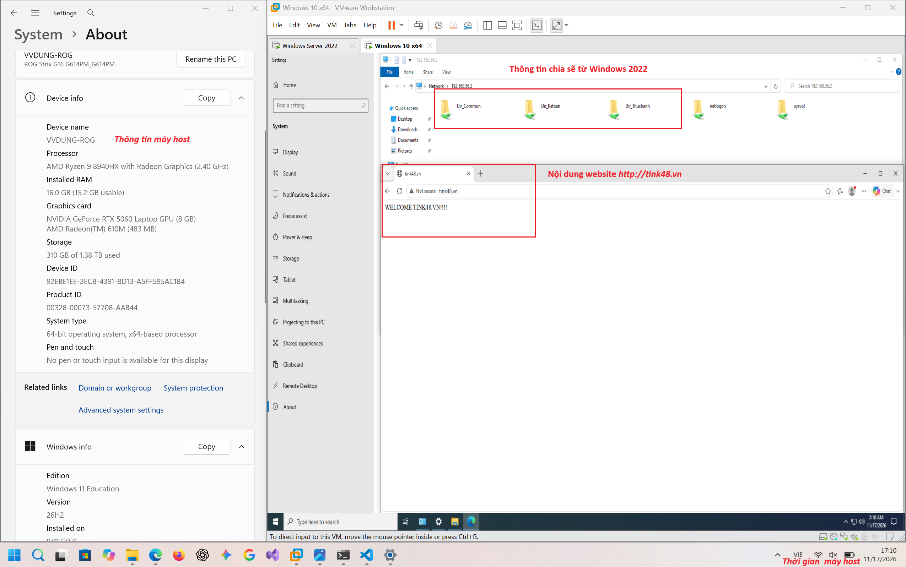

# Bài tập 2

## Cài đặt các dịch vụ DHCP, DNS, IIS, Domain Controller

## Cấu hình tham khảo
__1. Dịch vụ DHCP, DNS, IIS__

__2. Dịch vụ Domain Controller__

 
  
__3. Windows 10 - Đăng nhập Domain__

__4. Windows 10 - Cấu hình Domain__

__5. Windows 10 - Nội dung Share và WebSite__
